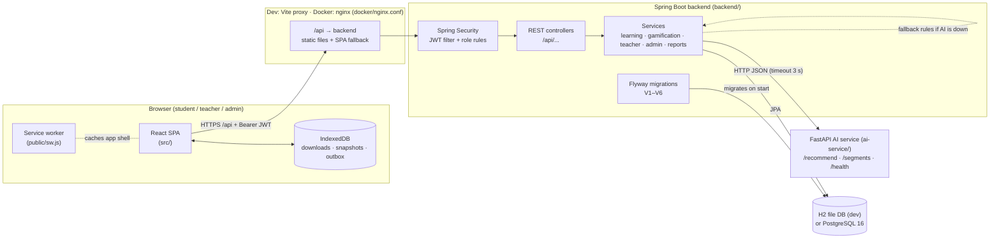

# ShikshaSetu — Gamified Learning Platform for Rural Education

An offline-first, gamified STEM learning platform for students in Grades 6–12, with teacher analytics, an admin console and an explainable recommendation service. The interface and the learning content are available in English, हिन्दी (Hindi), ଓଡ଼ିଆ (Odia) and తెలుగు (Telugu).

---

## Table of contents

1. [Overview](#overview)
2. [Key features](#key-features)
3. [Technology stack](#technology-stack)
4. [Project architecture](#project-architecture)
5. [Project structure](#project-structure)
6. [Prerequisites](#prerequisites)
7. [Installation & setup](#installation--setup)
8. [Environment variables](#environment-variables)
9. [Database setup](#database-setup)
10. [Running the application](#running-the-application)
11. [API documentation](#api-documentation)
12. [Authentication & authorization](#authentication--authorization)
13. [External services & integrations](#external-services--integrations)
14. [Testing & quality](#testing--quality)
15. [Troubleshooting](#troubleshooting)
16. [Known limitations](#known-limitations)

---

## Overview

**Problem.** Students in rural schools often have patchy internet, limited teacher time and learning material mostly in English. ShikshaSetu gives them bite-sized lessons and quizzes they can download and study offline in their own language. It motivates them with XP, levels, streaks, badges and missions, and gives their teachers real data on who needs help and with which topic.

**Audience.**
- **Students (Grades 6–12)** learn, take quizzes and track their progress.
- **Teachers** monitor their classes, find weak topics, assign work and download PDF progress reports.
- **The admin** (a single account) manages users, schools, classes and curriculum content.

**How the pieces fit together.**
- **Frontend:** a React single-page app, installable as a PWA. It talks to the backend only through `/api`.
- **Backend:** a Spring Boot REST API. It authenticates users with JWTs, enforces role-based access, stores everything through JPA in H2 (local development) or PostgreSQL (deployment) with Flyway migrations, and computes all scores and XP on the server.
- **AI service:** for recommendations and teacher segmentation, the backend calls a small Python FastAPI service built on pandas and scikit-learn. If it is unreachable, the backend falls back to built-in Java rules.
- **Offline mode:** the browser keeps downloaded chapters and a queue of offline actions in IndexedDB, and a service worker caches the app shell. Queued work is synced to the backend when the connection returns.

---

## Key features

### Implemented (verified in code and by automated tests)

**Student**
- **Account and onboarding:** registration and onboarding (grade, language, school, optional class code). A student can join a class later from their profile.
- **Dashboard:** level and XP, streak, lessons completed, average quiz score, badges, next lesson, progress by subject, daily missions, teacher assignments, recommendations and recent activity.
- **Curriculum:** Subjects → chapters → lessons (Markdown). The seed contains 5 subjects, 15 chapters, 30 lessons, 15 quizzes and 90 questions.
- **Quizzes:** one question at a time, with a timer and instant *Correct / Incorrect + explanation*.
  - Each answer is locked on the server before feedback is shown (see [Quiz security](#quiz-security)).
  - The whole attempt is graded on the server.
  - Reloading the page resumes the quiz.
- **Gamification** (`GamificationService`, `Levels`, `BadgeRule`):
  - **XP:** 20 per lesson. A first quiz attempt earns 10 per correct answer plus 20 for completing it; later attempts earn only the improvement over the best score. A perfect score adds 25.
  - **Levels:** `threshold(L) = 25·(L−1)·(L+2)`, i.e. 0 / 100 / 250 / 450 …
  - **Other rewards:** streaks, 9 badges, 4 daily missions, and a leaderboard (weekly, all-time, classmates).
- **Recommendations ("For You"):** each recommendation shows the evidence behind it (mastery per subject, weak topics).
- **Offline:**
  - download a chapter (its lessons plus the quiz without answers);
  - study and take the quiz offline;
  - offline actions are queued and synced automatically when back online (see [Offline behaviour](#offline-behaviour)).
- **Languages and display:** English, Hindi, Odia and Telugu for the interface and the lesson/quiz content; dark mode; lesson read-aloud through the browser's speech synthesis.

**Teacher**
- **Classes:** their classes, each with its join code; a class picker when they teach more than one class.
- **Class overview:** KPIs, average score by subject, score distribution, 14-day activity, completion by subject.
- **Students:** a student list with support segments (KMeans or rule-based), per-student detail with topic accuracy, and a weak-topics page with one-click remedial assignments.
- **Assignments:** a lesson or quiz, for the whole class or one student, with completion tracking.
- **Reports:**
  - per-student **PDF progress report** (`application/pdf`);
  - a **topic-accuracy CSV** (UTF-8 with BOM, one header row) for Excel / Power BI.

**Admin**
- **Platform statistics:** users, content, engagement and AI-service health.
- **Schools and classes:** create and edit, assign a teacher, regenerate join codes, delete (blocked while a class has students or a school has classes).
- **Users:** create students and teachers, edit, deactivate, delete, place a student in a class, and download a student's PDF report.
- **Content management:** subjects, chapters, lessons, quizzes and questions. Content that students have already completed or answered cannot be deleted.

**Platform**
- **Sign-in:** one form with a **Student / Teacher / Admin** role selector. The server rejects a role that doesn't match the account.
- **Registration:** **Student / Teacher** only. There is exactly one admin account.
- **Offline-safe writes:** idempotent offline sync, via unique lesson completions, a client attempt ID per quiz submission and a unique XP reference key.
- **PWA:** manifest, service worker (production builds only), IndexedDB storage.

### Partially implemented

- **Offline availability:**
  - lessons and quizzes are available offline only after **Download for offline** is pressed on their chapter; simply opening them online does not store them;
  - other screens (dashboard, subjects, subject and chapter pages, progress, badges, leaderboard) show their last-seen copy offline, but only if they were opened online at least once;
  - quizzes taken offline are scored only after sync, because the answer key never reaches the device.
- **Sync retries:** sync runs when the browser reports it is back online, when the app starts, and from the **Sync now** button. There is no periodic retry and no Background Sync API.
- **Translations:** complete for all seeded content and the interface, but drafted with AI assistance and **not yet reviewed by native-speaker teachers**.

### Planned / stubs

No `TODO`/stub markers were found in the application source. The known gaps are listed under [Known limitations](#known-limitations).

---

## Technology stack

Versions are taken from `package.json`, `backend/pom.xml`, `ai-service/requirements.txt`, the Dockerfiles and `docker-compose.yml`. Caret ranges (`^`) are the ranges declared in `package.json`; the exact installed versions are in `package-lock.json`.

| Layer / Category | Technology | Version (from manifests) | Purpose |
| :--- | :--- | :--- | :--- |
| Frontend | React / React DOM | `^19.2.7` | UI |
| Frontend | Vite | `^8.1.1` | Dev server, build, preview (with `/api` proxy) |
| Frontend | Tailwind CSS (+ `@tailwindcss/vite`) | `^4.3.3` | Styling |
| Frontend | React Router DOM | `^7.18.2` | Routing and role-guarded routes |
| Frontend | Chart.js / react-chartjs-2 | `^4.5.1` / `^5.3.1` | Dashboard and teacher charts |
| Frontend | idb | `^8.0.3` | IndexedDB wrapper for offline storage |
| Frontend | lucide-react | `^1.27.0` | Icons |
| Frontend | canvas-confetti | `^1.9.4` | Quiz result celebration |
| Frontend | clsx | `^2.1.1` | Class-name helper |
| Frontend | framer-motion | `^13.1.0` | Declared dependency; **not imported anywhere in `src/`** |
| Frontend tooling | ESLint (+ react-hooks, react-refresh plugins) | `^10.6.0` | Linting |
| Backend | Java | `21` (`java.version`) | Language level |
| Backend | Spring Boot (web, security, data-jpa, validation) | `3.5.16` (parent) | REST API, security, persistence |
| Backend | jjwt | `0.12.6` | JWT signing and verification (HS256) |
| Backend | Lombok | `1.18.48` | Boilerplate reduction |
| Backend | OpenPDF | `2.2.2` | PDF student reports |
| Backend | Flyway (core + PostgreSQL module) | Managed by Spring Boot `3.5.16` (not explicitly pinned) | Schema migrations |
| Backend | Maven (via wrapper) | `3.9.11` (wrapper `3.3.4`) | Build |
| Database | PostgreSQL JDBC driver | `42.7.12` | PostgreSQL connectivity |
| Database | H2 | Managed by Spring Boot `3.5.16` (not explicitly pinned) | Zero-install local database (PostgreSQL mode) |
| Database | PostgreSQL (Docker image) | `postgres:16-alpine` | Deployment database |
| AI service | Python (Docker image) | `python:3.12-slim` | Runtime |
| AI service | FastAPI / Uvicorn / Pydantic | `0.115.6` / `0.32.1` / `2.10.4` | HTTP service |
| AI service | pandas / NumPy / scikit-learn | `2.2.3` / `1.26.4` / `1.5.2` | Mastery estimation, KMeans segmentation |
| Testing | JUnit 5 / Spring Boot Test / Spring Security Test | Managed by Spring Boot `3.5.16` | Backend tests |
| Testing | zonky embedded-postgres | `2.1.0` | Real PostgreSQL in tests (no Docker needed) |
| Testing | pytest / httpx | `8.3.4` / `0.28.1` | AI service tests |
| Containers | Build / runtime images | `maven:3.9-eclipse-temurin-21`, `eclipse-temurin:21-jre`, `node:22-alpine`, `nginx:1.27-alpine` | Docker images |

---

## Project architecture



- **React SPA** (`src/`): all screens. `src/lib/api.js` attaches the JWT and the `Accept-Language` header to every call. `src/services/api.js` adds the offline fallbacks.
- **Service worker** (`public/sw.js`): registered only in production builds (`src/main.jsx`). It precaches the app shell and serves hashed assets cache-first; it never caches `/api/*`.
- **IndexedDB** (`src/lib/offlineStore.js`): downloaded chapters, last-seen screen snapshots, an outbox of offline actions, and synced quiz results. `src/lib/sync.js` replays the outbox in order.
- **Vite proxy / nginx:** in development and preview, Vite proxies `/api` to `BACKEND_URL`. In Docker, nginx serves the build, falls back to `index.html` for client routes, and proxies `/api` to the `backend` container.
- **Spring Boot backend:**
  - stateless JWT authentication and role rules in `SecurityConfig`;
  - business logic in services;
  - schema owned by Flyway, which Hibernate only validates;
  - seeders (`DataSeeder`, `TranslationSeeder`) load demo data into an empty database.
- **AI service:** pure functions over the answer history and lesson catalogue it receives. It stores no state and has no database.

---

## Project structure

```text
GameEducation/
├── src/                          # React frontend
│   ├── App.jsx                   # Routes: public, /student/*, /teacher/*, /admin/*
│   ├── main.jsx                  # Entry point; registers the service worker in production
│   ├── components/               # Original approved screens (landing, auth dialog, dashboards, lesson, quiz, …)
│   │   ├── routing/              # ProtectedRoute, GuestRoute, role → home mapping
│   │   └── ui/                   # Shared UI kit (Button, Card, Field, Modal, BarChart, …)
│   ├── pages/                    # Additional screens: student/, teacher/, admin/, public/
│   ├── context/AppContext.jsx    # Session, language, theme, connectivity, offline sync, toasts
│   ├── hooks/useApi.js           # Data-loading hook (reloads on language change)
│   ├── lib/                      # api.js (fetch + JWT), offlineStore.js (IndexedDB), sync.js (outbox)
│   ├── services/api.js           # Domain API calls with offline fallbacks
│   ├── i18n/                     # en/hi/or/te dictionaries, legacy dictionary, serverText helpers
│   └── data/constants.js         # Languages, grades
├── public/                       # sw.js, manifest.webmanifest, icons
├── backend/                      # Spring Boot API
│   ├── pom.xml · mvnw · mvnw.cmd # Maven build (wrapper included)
│   ├── Dockerfile
│   └── src/
│       ├── main/java/com/shikshasetu/
│       │   ├── security/         # SecurityConfig, JwtService, JwtAuthFilter, CurrentUser
│       │   ├── user/             # Auth (login/register/me/onboarding), users, student profiles
│       │   ├── content/          # Subjects, chapters, lessons, quizzes, translations, catalog API
│       │   ├── learning/         # Lesson completion, quiz sessions, submission, attempts
│       │   ├── gamification/     # XP, levels, badges, missions, leaderboard
│       │   ├── student/          # Student dashboard/progress APIs
│       │   ├── teacher/          # Teacher analytics, assignments, CSV/PDF reports
│       │   ├── school/           # Schools, classes, join codes
│       │   ├── admin/            # Admin stats, users, content management
│       │   ├── ai/               # AI client, Java fallback recommender, recommendations
│       │   ├── seed/             # DataSeeder, TranslationSeeder
│       │   └── common/           # AppProperties, TimeService, errors
│       ├── main/java/db/migration/   # V5 Java data migration
│       ├── main/resources/
│       │   ├── application.yml       # Configuration (profiles: dev, postgres)
│       │   ├── db/migration/         # V1–V4, V6 SQL migrations
│       │   └── seed/                 # content.json + i18n/<lang>/<subject>.json
│       └── test/java/…               # 8 test classes (23 tests)
├── ai-service/                   # FastAPI recommender
│   ├── main.py · recommender.py · segmentation.py · schemas.py
│   ├── requirements.txt · pytest.ini · tests/test_api.py
│   └── Dockerfile
├── docker/nginx.conf             # nginx config for the web image
├── Dockerfile                    # Frontend image (Vite build → nginx)
├── docker-compose.yml            # postgres (default) + ai, backend, web (profile "full")
├── docs/postman/                 # Postman collection (49 requests)
├── scripts/                      # check-i18n.mjs, validate_translations.py
├── .env.example                  # Documented configuration variables
├── package.json · vite.config.js · eslint.config.js · index.html
└── README.md
```

No CI/CD pipeline definitions (e.g. GitHub Actions workflows) exist in the repository.

---

## Prerequisites

| Tool | Version | Needed for |
| :--- | :--- | :--- |
| JDK | **21 or newer** (the code targets Java 21) | Backend |
| Node.js + npm | Not pinned in the repo (`package.json` has no `engines` field). Vite itself needs a current LTS (20.19+ / 22.12+); the Docker image uses Node 22 | Frontend |
| Python | **3.10+** (the Docker image uses 3.12) | AI service (optional) |
| Maven | Not required; the wrapper (`backend/mvnw`, `mvnw.cmd`) downloads Maven 3.9.11 | Backend build |
| PostgreSQL | 14+ (Compose uses 16) | Only for the `postgres` profile |
| Docker Desktop / Docker Engine with Compose v2 | Any recent version | Only for the Docker setup |

No PostgreSQL or Docker is needed for local development: the default `dev` profile uses an embedded H2 file database.

---

## Installation & setup

```bash
# 1. Clone
git clone <repository-url> GameEducation
cd GameEducation

# 2. Frontend dependencies
npm install

# 3. AI service virtual environment (optional; the backend falls back to Java rules without it)
cd ai-service
python -m venv .venv
.venv/Scripts/python -m pip install -r requirements.txt     # Linux/macOS: .venv/bin/python
cd ..

# 4. Backend: nothing to install; the Maven wrapper downloads Maven and dependencies on first run
```

Optional configuration (see [Environment variables](#environment-variables)):

- **Local backend:** add `JWT_SECRET=your_32_plus_character_random_secret` to `backend/.env` (create the file if needed), so sessions survive restarts.
- **Docker Compose:** add the same line to the repository-root `.env`; the `full` profile refuses to start without it.

Edit these files rather than overwriting them, as they may already hold your values.

---

## Environment variables

### Where the files live

| File | Read by | Notes |
| :--- | :--- | :--- |
| `./backend/.env` | Spring Boot (`spring.config.import: optional:file:.env[.properties]`) | Resolved relative to the backend's working directory, so run the backend from `backend/`. Properties format (`KEY=value`). Git-ignored. Real environment variables also work. |
| `./.env` (repository root) | Docker Compose (variable interpolation in `docker-compose.yml`) | Must contain `JWT_SECRET` for the `full` profile. Git-ignored. Vite also reads it. |
| `./.env.local` (repository root) | Vite (`loadEnv` in `vite.config.js` and `import.meta.env`) | Recommended place for frontend variables. Git-ignored (`*.local`). |
| `./.env.example` | Documentation only | Lists every variable, grouped by where it belongs. |

Never commit real secrets. Use placeholders such as `your_32_plus_character_random_secret`.

### Reference

| Variable | Required? | Purpose | Example / Fallback |
| :--- | :--- | :--- | :--- |
| **Frontend (Vite)** | | | |
| `VITE_API_URL` | No | API base URL used by the browser | Fallback `/api` |
| `BACKEND_URL` | No | Target of the Vite dev/preview `/api` proxy | Fallback `http://localhost:8080` |
| `VITE_DEMO_ACCOUNTS` | No | `true` lists the seeded demo accounts on the sign-in page of a production build (always listed in `npm run dev`) | Fallback: not shown |
| **Backend (Spring Boot)** | | | |
| `SPRING_PROFILES_ACTIVE` | No | `dev` (H2) or `postgres` | Fallback `dev` |
| `PORT` | No | HTTP port (read in `application.yml`; **not listed in `.env.example`**) | Fallback `8080` |
| `DATABASE_URL` | No (dev) / Yes (postgres, unless the default fits) | JDBC URL | dev: `jdbc:h2:file:./data/shikshasetu;MODE=PostgreSQL;…`; postgres: `jdbc:postgresql://localhost:5432/shikshasetu` |
| `DATABASE_USERNAME` | No | Database user | dev `sa`; postgres `shikshasetu` |
| `DATABASE_PASSWORD` | Yes for postgres | Database password | Fallback empty |
| `DATABASE_POOL_SIZE` | No | Hikari pool size (`postgres` profile only) | Fallback `10` |
| `JWT_SECRET` | **Yes for `postgres`**; recommended for `dev` | HS256 signing key, **at least 32 characters**. In `dev`, an empty value generates a random key on each start (sessions don't survive restarts); the `postgres` profile refuses to start without it. | `your_32_plus_character_random_secret` |
| `JWT_EXPIRATION_MINUTES` | No | Token lifetime | Fallback `720` (12 h) |
| `CORS_ALLOWED_ORIGINS` | No | Comma-separated browser origins allowed to call the API | Fallback `http://localhost:5173,http://localhost:4173` |
| `AI_SERVICE_URL` | No | Base URL of the FastAPI service | Fallback `http://localhost:8000` |
| `AI_SERVICE_TIMEOUT_MS` | No | Timeout for AI calls before falling back to Java rules | Fallback `3000` |
| `APP_TIMEZONE` | No | Time zone for days, streaks and report dates | Fallback `Asia/Kolkata` |
| `SEED_ENABLED` | No | Seeds curriculum, demo accounts and history into an **empty** database; also loads content translations | Fallback `true`; set `false` for real deployments |
| **Docker Compose (root `.env`)** | | | |
| `JWT_SECRET` | **Yes** (`full` profile) | Passed to the backend container; Compose errors out if unset | `your_32_plus_character_random_secret` |
| `POSTGRES_PASSWORD` | No | Password of the Compose PostgreSQL user `shikshasetu` (also passed to the backend) | Fallback `shikshasetu` (local only) |
| `DEMO_ACCOUNTS` | No | Build argument `VITE_DEMO_ACCOUNTS` for the web image | Fallback `true` |
| `CORS_ALLOWED_ORIGINS` | No | Passed to the backend container | Fallback `http://localhost:8081` |
| `SEED_ENABLED` | No | Passed to the backend container | Fallback `true` |

**Discrepancies found between `.env.example` and the code**
- `PORT` is read by the backend (`server.port: ${PORT:8080}`) but is not listed in `.env.example`.
- The Compose file fixes `DATABASE_USERNAME` to `shikshasetu` and `AI_SERVICE_URL` to `http://ai:8000` for the backend container; they cannot be overridden from the root `.env`.
- The AI service reads **no** environment variables; its port comes from the Uvicorn command line (`--port 8000`).

---

## Database setup

**Engines**
- **H2** (default `dev` profile): a file database in PostgreSQL compatibility mode, created automatically at `backend/data/shikshasetu.mv.db`. Nothing to install.
- **PostgreSQL 14+** (`postgres` profile): used by Docker Compose, which runs PostgreSQL 16.

**Schema: Flyway migrations** run automatically at start-up. Hibernate runs with `ddl-auto=validate` and never creates or alters tables.

| Version | File | Change |
| :--- | :--- | :--- |
| V1 | `db/migration/V1__baseline_schema.sql` | Users, profiles, curriculum, attempts, progress, XP, badges, recommendations, assignments |
| V2 | `db/migration/V2__quiz_sessions.sql` | Quiz sessions and locked answers |
| V3 | `db/migration/V3__content_translations.sql` | Translation tables for subjects, chapters, lessons, quizzes, questions, options |
| V4 | `db/migration/V4__schools_and_classes.sql` | Schools, classrooms, class links |
| V5 | `java/db/migration/V5__Move_students_into_classes.java` | Java data migration: existing teacher→student links become classes |
| V6 | `db/migration/V6__drop_direct_student_teacher_link.sql` | Drops the old link; every assignment targets one student or one class |

There is no separate migration command: starting the backend migrates the database. Any schema change needs a **new** migration file; never edit one that has already run, because Flyway checksums would then fail. Databases created by builds before Flyway existed are adopted as version 1 (`baseline-on-migrate: true`).

**Seeding.** With `SEED_ENABLED=true` and an **empty** `users` table, `DataSeeder` loads:
- the curriculum from `seed/content.json`;
- 1 admin, 1 teacher and 8 students, all in *Class 8 – Section A* at *Govt. High School, Sundargarh*;
- two weeks of simulated activity.

`TranslationSeeder` then loads Hindi, Odia and Telugu content from `seed/i18n/`. It only adds missing translations, and only where the stored English still matches the seed.

**PostgreSQL without Docker**

```sql
-- as a PostgreSQL superuser
create role shikshasetu login password 'your_db_password';
create database shikshasetu owner shikshasetu;
```

```bash
cd backend
SPRING_PROFILES_ACTIVE=postgres DATABASE_PASSWORD=your_db_password JWT_SECRET=your_32_plus_character_random_secret ./mvnw spring-boot:run
```

**PostgreSQL only, via Compose:** `docker compose up -d postgres` (user and database `shikshasetu`, host port `5432`, data in the named volume `pgdata`).

**Resetting demo data**
- H2: stop the backend and delete `backend/data/`.
- Compose: remove the `pgdata` volume. **This permanently deletes the database.**

### Demo accounts (development seed only)

Demo accounts are available in the development seed configuration (`backend/src/main/java/com/shikshasetu/seed/DataSeeder.java`).

> **Do not use development credentials in production.** Disable seeding (`SEED_ENABLED=false`) and the sign-in demo list (`DEMO_ACCOUNTS=false` / `VITE_DEMO_ACCOUNTS=false`) for any real deployment.

| Role | Email |
| :--- | :--- |
| Admin | `admin@shiksha.org` |
| Teacher | `teacher@shiksha.org` |
| Student | `aarav@shiksha.org` (plus seven more seeded students) |

In development and demo builds, the sign-in dialog's **Demo accounts** list signs these accounts in with one click, without displaying passwords.

---

## Running the application

### Local development (three terminals)

```bash
# Terminal 1 — AI service (optional)          → http://localhost:8000
cd ai-service
.venv/Scripts/python -m uvicorn main:app --port 8000        # Linux/macOS: .venv/bin/python

# Terminal 2 — backend (H2, dev profile)       → http://localhost:8080
cd backend
./mvnw spring-boot:run                                        # Windows cmd/PowerShell: mvnw.cmd spring-boot:run

# Terminal 3 — frontend dev server             → http://localhost:5173
npm run dev
```

The first backend start creates the H2 database and seeds it (about 10 seconds).

### Production build of the frontend (enables the service worker)

```bash
npm run build          # outputs dist/
npm run preview        # http://localhost:4173, also proxies /api to BACKEND_URL
```

Offline mode only works in production builds, because the service worker is registered only when `import.meta.env.PROD` is true.

### Backend as a jar

```bash
cd backend
./mvnw -DskipTests package
java -jar target/shikshasetu-backend-1.0.0.jar
```

### Docker Compose (whole stack)

```bash
# root .env must contain JWT_SECRET (32+ characters)
docker compose --profile full up --build -d
docker compose --profile full ps
```

| Service | Image / build | Host port | Notes |
| :--- | :--- | :--- | :--- |
| `web` | `Dockerfile` (Vite build → `nginx:1.27-alpine`) | `8081` → 80 | Serves the PWA, proxies `/api` to `backend:8080` |
| `backend` | `backend/Dockerfile` (`eclipse-temurin:21-jre`) | `8080` | `postgres` profile; waits for the PostgreSQL health check |
| `postgres` | `postgres:16-alpine` | `5432` | Health check `pg_isready`; data in volume `pgdata` |
| `ai` | `ai-service/Dockerfile` (`python:3.12-slim`) | not published (8000 inside the network) | Reached by the backend at `http://ai:8000` |

Without `--profile full`, `docker compose up -d` starts **only** PostgreSQL. Stop the stack with `docker compose --profile full stop` (or `down`); do **not** add `-v` unless you want to delete the database volume.

### Default URLs

| What | URL |
| :--- | :--- |
| Frontend (dev) | http://localhost:5173 |
| Frontend (preview) | http://localhost:4173 |
| Frontend (Docker) | http://localhost:8081 |
| Backend API | http://localhost:8080/api |
| Backend health (public) | http://localhost:8080/api/health |
| AI service health | http://localhost:8000/health (local run) |
| PostgreSQL (Docker) | `localhost:5432`, database and user `shikshasetu` |

---

## API documentation

All routes are under `/api`. Every request except login, register and `/api/health` needs `Authorization: Bearer <jwt>`.

- **JSON conventions:** fields that are `null` are omitted from responses (`default-property-inclusion: non_null`).
- **Language:** send `Accept-Language: hi|or|te|en` to receive curriculum text in that language (English fallback).
- **Full examples:** see the Postman collection in `docs/postman/`.

**Error format** (all errors):

```json
{ "status": 401, "code": "ROLE_MISMATCH", "message": "This account is not a teacher account. Choose the right role and try again.", "timestamp": "2026-09-26T06:30:00Z" }
```

Validation errors add `"fieldErrors": { "email": "Enter a valid email" }`.

### Auth & profile

| Method & path | Auth | Purpose |
| :--- | :--- | :--- |
| `POST /api/auth/login` | Public | Sign in. Body `{ "email", "password", "role"? }` (`role`: `STUDENT`/`TEACHER`/`ADMIN`; a mismatch returns 401 `ROLE_MISMATCH`) |
| `POST /api/auth/register` | Public | Sign up. Body `{ "name", "email", "password" (8–72), "role"?: "STUDENT"\|"TEACHER", "gradeLevel"? (6–12) }`. `ADMIN` returns 400 `ROLE_NOT_ALLOWED`. Returns 201 |
| `GET /api/auth/me` | Bearer (any role) | Current user |
| `PUT /api/users/me` | Bearer (any role) | Update name, language, grade, school, district |
| `PUT /api/students/me/onboarding` | Student | `{ "gradeLevel", "preferredLanguage": "en\|hi\|or\|te", "school"?, "district"?, "classCode"? }` |
| `PUT /api/students/me/class` | Student | Join a class: `{ "joinCode" }` (404 `INVALID_CLASS_CODE` if unknown) |
| `GET /api/health` | Public | `{ "status": "ok" }` |

Sample `POST /api/auth/login` response:

```json
{
  "token": "<jwt>",
  "expiresInSeconds": 43200,
  "user": {
    "id": 3, "name": "Aarav Sharma", "email": "aarav@shiksha.org", "role": "STUDENT",
    "preferredLanguage": "en", "onboarded": true, "gradeLevel": 8,
    "school": "Govt. High School, Sundargarh", "district": "Sundargarh, Odisha",
    "xp": 1145, "level": 6, "streak": 6,
    "classId": 1, "className": "Class 8 – Section A", "teacherName": "Sunita Kullu"
  }
}
```

### Curriculum (any signed-in role)

| Method & path | Purpose |
| :--- | :--- |
| `GET /api/subjects` | Subjects with the caller's progress |
| `GET /api/subjects/{id}` | Subject with its chapters |
| `GET /api/chapters/{id}` | Chapter with lessons and quiz summary |
| `GET /api/chapters/{id}/offline-bundle` | Chapter + all lessons + quiz (no answers) for offline use |
| `GET /api/lessons/{id}` | Lesson (Markdown `content`, `language` actually served) |
| `GET /api/quizzes/{id}` | Quiz questions and options, **without** correct answers |
| `GET /api/catalog/outline` | Subject → chapter → lesson/quiz titles |

Sample `GET /api/quizzes/1` (abridged):

```json
{ "id": 1, "title": "Linear Equations Quiz", "timeLimitSeconds": 300, "language": "en",
  "questions": [ { "id": 1, "prompt": "Solve: 3x + 5 = 20", "options": ["x = 5", "x = 25/3", "x = 15", "x = 3"], "topic": "linear-equations", "position": 1 } ] }
```

### Learning (Student)

| Method & path | Purpose |
| :--- | :--- |
| `POST /api/lessons/{id}/complete` | Complete a lesson (idempotent). Optional body `{ "completedAt", "offline" }` for synced offline actions |
| `POST /api/quizzes/{id}/session` | Start or resume the quiz session; returns already-locked answers |
| `POST /api/quizzes/{id}/session/answers` | Lock one answer `{ "questionId", "selectedIndex" }` and get feedback |
| `POST /api/quizzes/{id}/submit` | Grade the attempt: `{ "answers": [{ "questionId", "selectedIndex" }], "timeTakenSeconds"?, "clientAttemptId"?, "submittedAt"?, "offline"? }` |
| `GET /api/students/me/attempts` · `/attempts/{attemptId}` | Attempt history / detail |
| `GET /api/students/me/{dashboard,progress,badges,xp,missions,assignments}` | Student views |
| `GET /api/students/me/recommendations?limit=4` | Recommendations (limit 1–10) with `source` = `ai-service` or `fallback` |
| `GET /api/students/me/leaderboard?scope=all\|week\|class&limit=20` | Leaderboard (limit 1–100) |

Sample `POST /api/quizzes/1/session/answers` response:

```json
{ "questionId": 1, "selectedIndex": 0, "correct": true, "correctIndex": 0,
  "explanation": "Subtract 5 from both sides to get 3x = 15, then divide by 3 to get x = 5.", "alreadyAnswered": false }
```

### Teacher

Views accept an optional `?classId=`; another teacher's class or student returns 404.

| Method & path | Purpose |
| :--- | :--- |
| `GET /api/teacher/classes` | The teacher's classes (with join codes) |
| `GET /api/teacher/overview` | KPIs, charts data, segments, recent activity |
| `GET /api/teacher/students` · `/students/{id}` | Student list / detail |
| `GET /api/teacher/weak-topics` | Topic accuracy across the class |
| `GET /api/teacher/students/{id}/report.pdf` | **PDF** progress report (`application/pdf`, `student-report-<id>.pdf`) |
| `GET /api/teacher/reports/topics.csv` | Topic-accuracy **CSV** (`class-topics.csv`) |
| `GET /api/teacher/assignments` | Assignments with completion counts |
| `POST /api/teacher/assignments` | `{ "title", "note"?, "dueDate"?, "lessonId"\|"quizId", "studentId"? \| "classId"? }` |
| `DELETE /api/teacher/assignments/{id}` | Delete an assignment |

### Admin

| Method & path | Purpose |
| :--- | :--- |
| `GET /api/admin/stats` | Platform statistics (incl. AI-service health) |
| `GET/POST /api/admin/users` · `PUT/DELETE /api/admin/users/{id}` | User management (create: `STUDENT`/`TEACHER` only) |
| `GET /api/admin/students/{id}/report.pdf` | PDF report for any student |
| `GET/POST /api/admin/schools` · `PUT/DELETE /api/admin/schools/{id}` | Schools (the GET includes each school's classes) |
| `POST /api/admin/classes` · `PUT/DELETE /api/admin/classes/{id}` · `POST /api/admin/classes/{id}/join-code` | Classes and join-code regeneration (there is no separate `GET /api/admin/classes`) |
| `GET /api/admin/content` | Full content tree |
| `POST /api/admin/{subjects,chapters,lessons,quizzes,questions}` · `PUT/DELETE …/{id}` · `GET /api/admin/lessons/{id}` · `GET /api/admin/quizzes/{id}` | Content management |

### AI service (internal, called by the backend)

| Method & path | Purpose |
| :--- | :--- |
| `GET /health` | `{ "status": "ok", "service": "ai-recommender", "version": "1.0.0" }` |
| `POST /recommend` | Mastery per subject, weak topics and ranked lesson recommendations |
| `POST /segments` | KMeans (k = 3) student segmentation with rule-based safety overrides |

FastAPI also serves its interactive docs at `/docs` (framework default).

---

## Authentication & authorization

- **Passwords:** hashed with BCrypt (`BCryptPasswordEncoder`).
- **Tokens:** `POST /api/auth/login` returns an HS256 JWT signed with `JWT_SECRET`, containing the subject (user ID), `role` and `name` claims. Default lifetime is 720 minutes (`JWT_EXPIRATION_MINUTES`). There is no refresh token; after expiry the user signs in again.
- **Stateless requests:** `JwtAuthFilter` reads `Authorization: Bearer …` on every request and reloads the user. Deactivated accounts and role changes therefore take effect immediately. CSRF protection is disabled because no cookies are used.
- **Role rules** (`SecurityConfig`):
  - `/api/students/**` and the learning write endpoints (`lessons/*/complete`, `quizzes/*/submit|session|session/answers`) → `STUDENT`;
  - `/api/teacher/**` → `TEACHER`;
  - `/api/admin/**` → `ADMIN`;
  - all other `/api/**` → any authenticated user;
  - login, register, `/api/health` and CORS pre-flight → public.
  - Failures return `401 UNAUTHENTICATED` or `403 FORBIDDEN`.
- **Data scoping:** teachers only reach students in classes they teach (404 otherwise). Students only reach their own data (`/me` endpoints).
- **Role checks at sign-in:** the optional `role` in the login body is compared with the stored role after the password check. A mismatch returns `401 ROLE_MISMATCH` and issues no token.
- **Single admin:**
  - public registration accepts only `STUDENT` and `TEACHER`;
  - admin-created users are likewise limited to `STUDENT`/`TEACHER`;
  - no endpoint changes a user's role;
  - the seeded `admin@shiksha.org` is the only admin.
- **Frontend guards:**
  - `ProtectedRoute` and `GuestRoute` redirect by role, sending the user to their own home (`/student|/teacher|/admin/dashboard`). They improve the experience only; the backend is the authority.
  - The token is stored in `localStorage` (`shikshasetu.token`).
  - A 401 on an authenticated call signs the user out with a "session expired" message.
- **CORS:** only origins listed in `CORS_ALLOWED_ORIGINS` may call `/api/**` from a browser.

### Quiz security

- **Question payloads:** they never contain the answer key.
- **Answer locking:** instant feedback is returned only for an answer that has been stored in the quiz session. A stored answer cannot be changed.
- **Grading:** the final grade uses the stored answers, even for offline submissions that claim otherwise.
- **Remaining trade-offs:** the correct option is revealed once a student commits to an answer, and the quiz timer runs in the browser.

### Offline behaviour

| Level | Status |
| :--- | :--- |
| App shell after a first online visit | Works (service worker, production builds) |
| Lessons and quizzes | Only for chapters saved with **Download for offline** |
| Read-only screens (dashboard, subjects, progress, badges, leaderboard) | Last-seen copy, if opened online before |
| Taking a quiz offline | Answers are stored locally; no score until sync (the answer key is never on the device) |
| Sync | Automatic on reconnect / app start / **Sync now**; idempotent; verified to reach the database |

---

## External services & integrations

- **ShikshaSetu AI service** (this repository, `ai-service/`): the only service the backend calls. No account or API key is needed.
- **Google Fonts:** loaded by the frontend and cached by the service worker (stale-while-revalidate).
- **Maven Central:** used at build and first test run (dependencies and the embedded-PostgreSQL binaries).

No third-party SaaS integrations (payments, cloud storage, LLM APIs, OAuth providers, email/SMS) are present in the code, and **no external API keys are required**.

### How the "AI" works

- **Mastery / weak topics** (`recommender.py`): for each topic, a recency-weighted accuracy (half-life 14 days) smoothed with a Beta(1,1) prior. Topics below 60% with at least 2 answers are weak. Recommendations are ranked by `(1 − mastery) × confidence`, and every reason quotes the real numbers.
- **Segmentation** (`segmentation.py`): scikit-learn `KMeans` (k = 3) on standardised [average score, lessons, attempts, active days]. Students under 50% or with no attempts are always flagged. Fewer than 3 students falls back to rules.
- This is a transparent statistical model, not deep learning. If the service is down, the backend uses Java rules and reports `source: fallback`.

---

## Testing & quality

| Suite | Command | Scope |
| :--- | :--- | :--- |
| Backend | `cd backend && ./mvnw test` | 8 classes / 23 tests: `ApiIntegrationTest`, `AuthRoleAndReportTest`, `QuizSecurityTest`, `ContentLocalizationTest`, `ClassModelTest`, `ClassMigrationTest` (H2 **and** PostgreSQL), `PostgresMigrationTest`, `LevelsTest` |
| AI service | `cd ai-service && .venv/Scripts/python -m pytest -q` | `tests/test_api.py` (18 tests): mastery, recommendations, segmentation, validation |
| Frontend lint | `npm run lint` | ESLint over the project |
| Frontend build | `npm run build` | Production build |
| UI dictionaries | `node scripts/check-i18n.mjs` | Same keys, `{placeholders}` and script in `hi`/`or`/`te` as in `en` |
| Content translations | `python scripts/validate_translations.py` | Structure, verbatim code/formulas, numbers, script and answer-key safety of `seed/i18n` |
| API (Postman) | `npx newman run docs/postman/ShikshaSetu.postman_collection.json` | 49 requests / 90 assertions against a running backend. Change the base URL with `--env-var baseUrl=http://localhost:8080/api`. |

- **Clean builds:** after changing the Java version or large refactors, use `./mvnw clean …`. Stale classes in `target/` can hide compile errors.
- **PostgreSQL tests:** they start real PostgreSQL binaries through `io.zonky.test:embedded-postgres`, so no Docker is needed. The first run downloads them.
- **Browser tests:** no end-to-end browser tests are committed to the repository. Browser checks during development were run with external Playwright scripts.

---

## Troubleshooting

| Symptom | Cause | Fix |
| :--- | :--- | :--- |
| `failed to connect to the docker API at npipe:////./pipe/dockerDesktopLinuxEngine` | Docker Desktop is not running | Start Docker Desktop (or run `docker desktop start`), wait until the engine is up, and check with `docker info` |
| `required variable JWT_SECRET is missing` / "Set JWT_SECRET to at least 32 random characters" | Compose needs `JWT_SECRET` | Add `JWT_SECRET=your_32_plus_character_random_secret` to the **root** `.env` |
| Backend exits with "JWT_SECRET must be set …" | The `postgres` profile requires a secret | Set `JWT_SECRET` (32+ chars) as an env var or in `backend/.env` |
| `JWT_SECRET must be at least 32 characters` | Secret too short | Use a longer random value |
| `release version NN not supported` during the Maven build | Your JDK is older than `java.version` in `pom.xml` (21) | Install JDK 21+ and make sure `./mvnw -version` shows it; then run `./mvnw clean compile` |
| Port already in use (5173, 4173, 8080, 8000, 8081, 5432) | Another process holds the port | Stop it, or change `PORT` (backend), Vite's `--port`, or the Compose port mappings |
| Login from a new frontend origin returns 403 | Origin not allowed by CORS | Add the origin to `CORS_ALLOWED_ORIGINS` |
| Backend fails with a Flyway checksum or Hibernate validation error | An applied migration was edited, or entities don't match the schema | Restore the original migration and add a new `V<n>__….sql`. For local H2 data you can delete `backend/data/` to start fresh |
| Offline mode does nothing in `npm run dev` | The service worker is registered only in production builds | Use `npm run build && npm run preview` (or Docker) |
| Old UI after a deploy | Service worker still serving the previous shell | Reload twice or unregister the service worker (DevTools → Application) |
| Demo accounts not listed on the sign-in page | Production build without `VITE_DEMO_ACCOUNTS=true` | Expected for real deployments; for demos set the variable (Docker: `DEMO_ACCOUNTS=true`) and rebuild |
| Recommendations show `source: fallback` | AI service unreachable or slow (> `AI_SERVICE_TIMEOUT_MS`) | Start the AI service on port 8000 or fix `AI_SERVICE_URL` |
| First `./mvnw test` is slow | Maven dependencies and embedded-PostgreSQL binaries are downloaded | Normal on the first run |
| `./mvnw` not recognised on Windows | Shell differences | Use `mvnw.cmd` in cmd/PowerShell |
| A new student is invisible to teachers | The student has not joined a class | Enter the class code in onboarding or the profile, or place the student via admin **Users** |

---

## Known limitations

- **Translations:** AI-assisted and validated by scripts, but not yet reviewed by native-speaker teachers. English content edited by an admin does not update its translations. Teacher-typed text and the XP history stay in the language they were written in.
- **PDF reports:** generated in English with the built-in Helvetica font (OpenPDF cannot shape Devanagari, Odia or Telugu). Names typed in those scripts will not render in the PDF.
- **Offline:** viewing a lesson or quiz online does not save it for offline use (only **Download for offline** does). Offline quizzes are scored only after sync. There is no periodic sync retry.
- **Quiz timer:** enforced only in the browser.
- **Recommendations:** with a class of about 8 students, the KMeans segments are indicative only.
- **Teacher sign-up:** open to anyone. A new teacher sees no students until an admin assigns them a class; there is no approval step.
- **Docker hardening:**
  - only PostgreSQL has a health check, and no restart policies are set;
  - PostgreSQL (5432) and the backend (8080) are published on the host;
  - the Compose database password defaults to a local-only value.
  - Harden these before any shared deployment.
- **Bundle size:** the main JavaScript bundle is large (all four UI dictionaries are included). Teacher and admin screens are code-split.
- **Unused dependency:** `framer-motion` is declared in `package.json` but not imported in `src/`.
